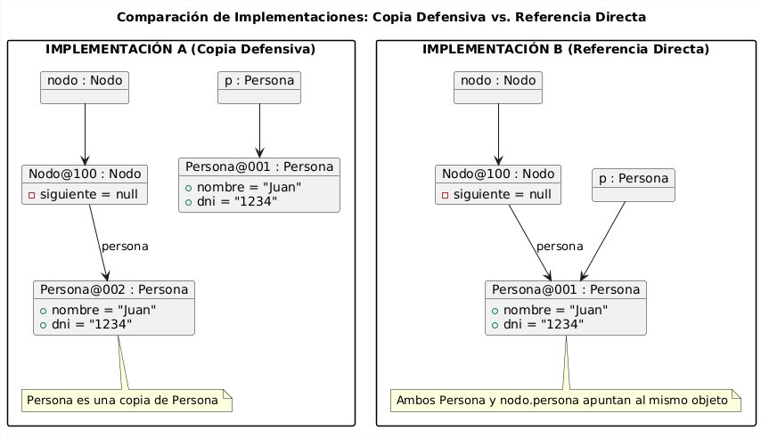
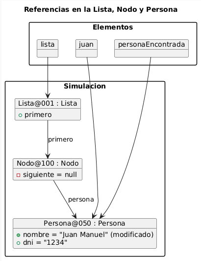
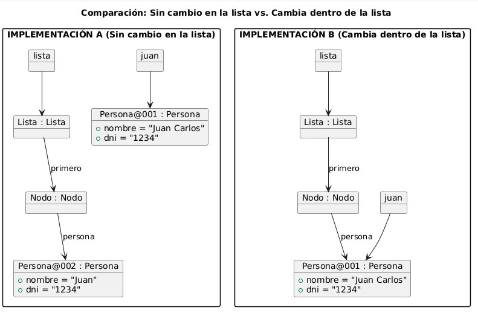
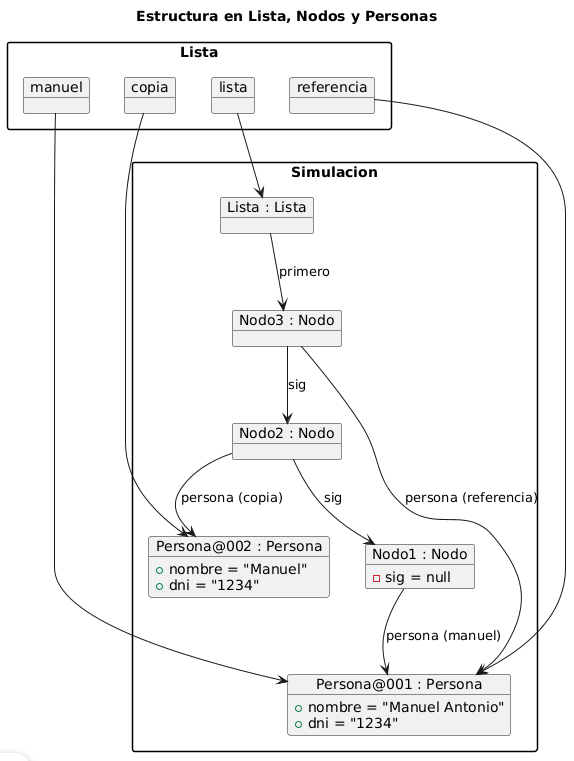

# Resolución del Examen - Estructuras de Datos y Algoritmos I (EDA 1)

---

## 1. Análisis de implementaciones 

### A. ¿Qué implementación considera que utiliza mejor los recursos de memoria? Justifique su respuesta.

La **Implementación B** utiliza mejor los recursos de memoria.

* **Razón:** En la Implementación B, el `Nodo` guarda directamente la referencia al objeto `Persona` recibido en el constructor. En la Implementación A, el constructor realiza una copia defensiva instanciando un nuevo objeto `Persona` (`new Persona(...)`). Esto implica duplicar la memoria asignada para cada nodo creado.

---

### B. ¿Qué problemas o ventajas podría causar cada implementación? Proporcione ejemplos.

* **Implementación A:**
  * **Ventaja:** Al crear un nuevo objeto `Persona`, si el objeto original fuera de la lista se modifica, el objeto interno almacenado en el nodo permanece intacto.
  * **Problema:** Si insertamos $N$ veces el mismo objeto `Persona`, se instanciarán $N$ objetos `Persona` nuevos idénticos.

* **Implementación B:**
  * **Ventaja:**  No crea objetos redundantes.
  * **Problema:** Si desde fuera de la lista se modifica el objeto `Persona` original, la lista reflejará inmediatamente dicho cambio, perdiendo la encapsulación defensiva.

#### Diagramas de memoria (1.B)



### C. ¿Cómo afectaría cada implementación al comportamiento de una lista que use estos nodos?

* **Lista con Nodo A:**

    * Los elementos dentro de la lista quedan protegidos contra modificaciones externas. Sin embargo, la igualdad por referencia (==) fallará al comparar la persona dentro de la lista con la persona original, obligando a buscar siempre por valor o contenido.

* **Lista con Nodo B:** 
    * La lista reflejará cambios externos en tiempo real. Si un objeto Persona es modificado en otra parte del sistema, su estado cambia automáticamente dentro de la lista. Además, múltiples nodos o listas pueden compartir la misma instancia de Persona en memoria.


## 2. Gestión de referencias

### A. Nombre de la persona almacenada en la lista al hacer personaEncontrada.setNombre("Juan Manuel")

* Resultado: El nombre pasará a ser "Juan Manuel".

* Por qué: obtenerPersona("1234") retorna la misma referencia de memoria al objeto Persona que está almacenado dentro del Nodo de la lista. personaEncontrada y nodo.persona apuntan al mismo objeto.



### B. ¿Qué sucedería si modificamos juan.setNombre("Juan Carlos") después de insertarlo? ¿Depende de la implementación del Nodo (A o B)?

* Si se usa la Implementación A: El nombre dentro de la lista SE MANTIENE como "Juan". El nodo guarda una copia (Persona) independiente de la instancia original juan (Persona@001).

* Si se usa la Implementación B: El nombre dentro de la lista CAMBIA a "Juan Carlos". Tanto juan como el nodo comparten la misma referencia (Persona).



## 3. Referencias y constructores

### A. ¿Cuántos objetos Persona diferentes hay en memoria? Justifique su respuesta.

Hay **exactamente 2 objetos `Persona` diferentes** en memoria. Esto se debe a que al ejecutar `manuel = new Persona("Manuel", "1234");` se instancia el **Objeto 1** en la memoria dinámica, mientras que la línea `copia = new Persona(manuel);` invoca el constructor copia para crear un **Objeto 2** totalmente independiente en otra ubicación de la memoria; por último, la asignación `referencia = manuel;` no genera ninguna instancia nueva, sino que simplemente copia la dirección de memoria de la variable `manuel`, haciendo que `referencia` apunte exactamente al mismo **Objeto 1**. Por tanto, aunque la lista realice 3 inserciones (`manuel`, `copia`, `referencia`), en total solo existen 2 instancias físicas registradas.

### B. Si hacemos manuel.setNombre("Manuel Antonio"), ¿qué elementos de la lista se verán afectados? ¿Por qué? 

* Se verán afectados el primer y el tercer elemento insertados (asumiendo la Implementación B de nodo).

    * Razón:

        * El 1.º elemento insertado (manuel) y el 3.º elemento insertado (referencia) comparten la misma dirección de memoria (Persona). Por lo tanto, el cambio se reflejará en ambos.

        * El 2.º elemento insertado (copia) apunta a un objeto independiente (Persona), por lo que conservará el nombre "Manuel" sin alteración.


## Diagrama de memoria (3.a y 3.b)



## 4. Diseño y optimización

Implementación propuesta para la clase Lista, esta adentro de la carpeta src y se llama
[Lista.java](/workspaces/26-27-eda1/rafaelKaterine/src)

```java
public class Lista {
    private Nodo primero;

    private static class Nodo {
        Persona persona;
        Nodo siguiente;

        Nodo(Persona persona, Nodo siguiente) {
            this.persona = persona;
            this.siguiente = siguiente;
        }
    }

    public boolean existeReferencia(Persona persona) {
        Nodo actual = primero;
        while (actual != null) {
            if (actual.persona == persona) { 
                return true;
            }
            actual = actual.siguiente;
        }
        return false;
    }

    public boolean insertar(Persona persona, boolean hacerCopia) {
        if (persona == null) return false;

        if (existeReferencia(persona)) {
            return false; 
        }

        Persona personaAInsertar = hacerCopia ? new Persona(persona) : persona;
        primero = new Nodo(personaAInsertar, primero);
        return true;
    }

}
```

* Explicación del diseño y decisiones tomadas:

    * La gestión eficiente de memoria y objetos se realiza mediante la comparación directa de direcciones (persona == persona) para la detección instantánea de entidades registradas, ofreciendo flexibilidad a través del parámetro hacerCopia para que el cliente elija entre la seguridad de la copia defensiva (true) o la maximización de la eficiencia reutilizando referencias (false). Asimismo, se optimiza el tiempo y el uso de memoria declarando la clase interna Nodo como static evitando referencias implícitas a la clase contenedora.


## 5. Análisis de código

### A. ¿Qué problemas potenciales ve en este código respecto al manejo de referencias?


* En agregarPersona, al guardar directamente la referencia recibida por parámetro, si el código cliente modifica la persona fuera del gestor más adelante, el objeto dentro de la lista también cambiará, pudiendo corromper la consistencia de los datos almacenados.

### B. ¿Cómo lo mejoraría para evitar modificaciones no deseadas de los objetos?

* agregarPersona debe almacenar una copia del objeto recibido para aislar el gestor de cambios externos.

### C. Proponga una solución que proteja la integridad de los datos.

```java
public class GestorPersonas {
    private Lista lista;

    public GestorPersonas() {
        this.lista = new Lista();
    }

    public void agregarPersona(Persona persona) {
        if (persona == null) return;
        
        Persona copia = new Persona(persona);

        if (!lista.contiene(copia)) {
            lista.insertarPersona(copia);
        }
    }

    public Persona buscarPersona(String dni) {
        return lista.obtenerPersona(dni);
    }
```

